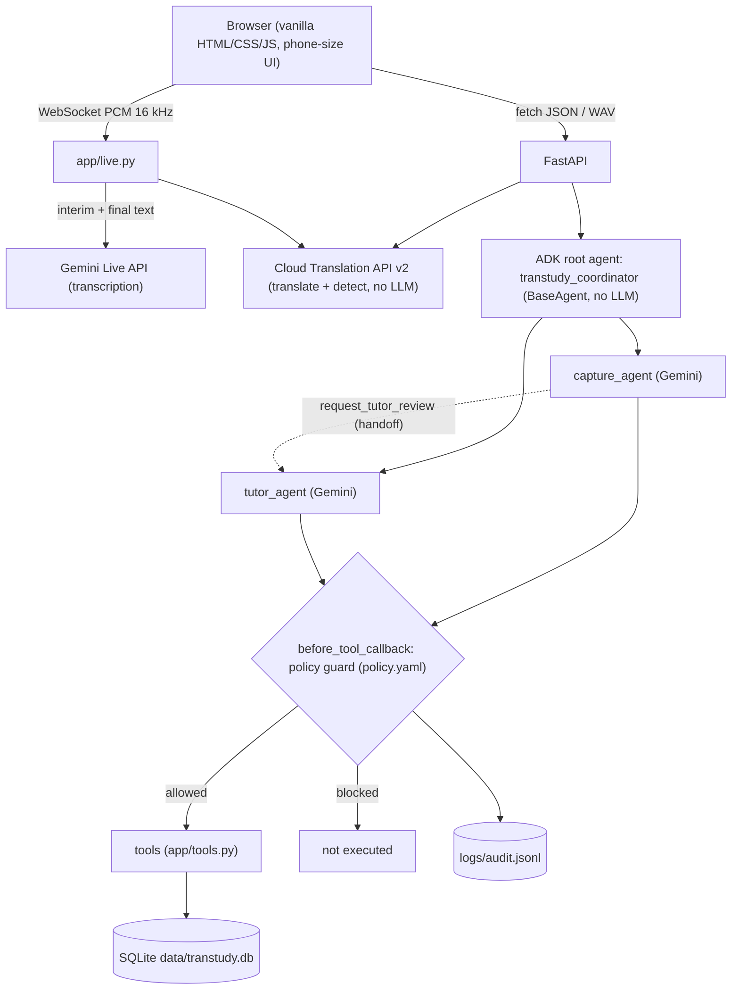

# Transtudy

**Translate in the moment, learn it later.** Speak or type in English or Spanish (or German). Transtudy translates instantly, and two Google ADK agents file every lookup into a wordbook, write example sentences and build today's review, so lookups turn into lessons. Every tool call passes a policy-as-code guard and lands in an audit log.

Built in two hours at **DevFest Münster 2026 — Agentic AI Hackathon** (Build, Secure, Scale).

## The problem

Looking a word up and actually learning it are two separate things today:

| Tool | Good at | Missing |
|---|---|---|
| Notes app | quick to write | not sorted, buried among other notes |
| Translation apps | instant translation | history just scrolls away; not made for study |
| Vocabulary books | studying | too slow to use in a shop or a conversation |
| General chatbots | great explanations | you type a prompt every time; nothing is organised or reviewed |

I am a Japanese exchange student in Spain, learning Spanish through English. I look words up every day and forget them. Transtudy connects the lookup (seconds, one hand) to the learning (five minutes later).

## What it does

- **Tap and speak** (or type). English → Spanish is filed as **Couldn't say** (speaking gap); Spanish → English as **Didn't catch** (listening gap). The direction is decided by code from the detected language.
- **Capture Agent** checks the wordbook for the same or a similar entry, then saves it or counts it again. The 3rd lookup makes it a **weak word** and the Capture Agent **hands it over to the Tutor Agent**.
- **Tutor Agent** (in the background) writes an example sentence when it helps and decides **today's review list** (max 7 words): which word to drop for the new one, and why.
- **Lessons**: flashcards (English → Spanish), Forgot / Remembered. During a Today's review lesson the Tutor Agent decides whether each word stays on today's list.
- **Wordbook**: two books with paper pages, examples and a draggable **red sheet** that hides one language.
- **Agent log**: every tool call with agent, arguments, allowed/blocked and the reason.

## Architecture



### Agent flow for one lookup

```mermaid
sequenceDiagram
  participant U as User
  participant S as Server
  participant C as Capture Agent
  participant T as Tutor Agent
  U->>S: "bag" (voice or text)
  S->>S: detect language, translate (Cloud Translation), show "bolsa" at once
  S->>C: <user_utterance>bag</user_utterance>
  C->>S: find_similar_entries -> exact: bolsa (2x)
  C->>S: bump_lookup_count -> 3x, became_weak = true
  C->>S: request_tutor_review(bolsa, "looked up 3 times")
  S->>T: <today_review> 7 words, <review_candidate> bolsa, <handoff_note>
  T->>S: save_example + update_today_review(add bolsa, drop la cuenta, "remembered twice in a row")
  S-->>U: "Tutor Agent: added bolsa; dropped la cuenta, ..."
```

The translation never waits for an LLM. Gemini is called only for decisions: 2 calls per text lookup (search → save/count), 1 per lesson answer, 1 per background review.

## Agents and tools (least privilege)

| Tool | Agent | Permission |
|---|---|---|
| `find_similar_entries(text, target_lang)` | capture | read only (exact + up to 5 similar, decided by code rules) |
| `save_entry(source_text, note)` | capture | insert only; the text must equal the user's input; translation filled by the server |
| `bump_lookup_count(entry_id)` | capture | +1 only, only ids returned by the search; 3+ = weak |
| `request_tutor_review(entry_id, reason)` | capture | hand over a word that just became weak, once |
| `update_today_review(add, drop, why)` | tutor | add the server's candidate; drop one word on the list; max 7 |
| `set_today_review(entry_ids, why)` | tutor | new-day rebuild only, 1–7 ids from the server's candidates |
| `record_result(entry_id, remembered, requeue, keep_in_today)` | tutor | score fields only; must match the user's answer; requeue once |
| `get_example_candidates()` | tutor | read only, server-chosen words |
| `save_example(entry_id, example_target, example_english)` | tutor | fill an **empty** example field only, plain text, ≤140 chars |

No agent has a delete, settings or code-execution tool. Deleting is a human action (confirm dialog → `DELETE /api/entries/{id}`).

## Security

| Measure | How | OWASP |
|---|---|---|
| Input is data, not instructions | User text is wrapped in `<user_utterance>`; the system instruction says to never follow it. Data tags: `user_utterance`, `wordbook_data`, `lesson_filters`, `handoff_note`, `today_review`, `review_candidate`, `review_candidates`. Input containing a tag name is rejected. Translation is done by a non-LLM API. | LLM01, ASI01 |
| Policy-as-code | `policy.yaml` lists each agent's tools and limits. ADK `before_tool_callback` checks **every** call; violations are not executed and are logged as `blocked`. | LLM06, ASI02 |
| Argument checks | Saved text must equal the input; no save before search; counts only for search results; scores must match the answer; examples only for server-chosen words, no `<` `>` `://`, never overwritten. | ASI01, ASI06 |
| Limited agent-to-agent handoff | Only a word that just became weak, once, plain-text reason ≤120 chars; the Tutor may add only the server's candidate, once per run, max 7 words. | ASI01, ASI10 |
| Least privilege | Tool table above. Translation API key restricted to the Translation API. | LLM06, ASI03 |
| Secrets | Keys only in `.env` (git-ignored). The Translation key is sent in the `X-Goog-Api-Key` header, never in a URL; httpx INFO logs are off. | ASI03 |
| Output handling | All user text, translations and agent text are rendered with `textContent`, never `innerHTML`. | LLM05 |
| Memory poisoning | Wordbook data passed to the Tutor is wrapped as data; tool ids are limited to what the server passed. | ASI06 |
| Keep a word | Only words that are in the sentence, ≤40 chars. | LLM01, ASI06 |
| Overuse | 15 s / 1 MB audio, 300 chars, 20 requests per minute per client. | LLM10 |
| WebSocket origin | `/api/capture/live` closes connections whose `Origin` is not this server. | LLM10 |
| Privacy (GDPR) | Audio is processed in memory and never stored. No location. No audio or keys in logs. Silent recordings are never sent to Gemini (so it cannot invent a sentence). | LLM02 |
| Audit log | Every tool call → `logs/audit.jsonl` (time, agent, tool, argument summary, allowed/blocked, reason). Visible in the app (… → Agent log). | ASI10 |
| No code execution | No tool runs code. | ASI05 |

Proof: `python scripts/red_team_demo.py` sends 16 hijacked-agent tool calls to the real guard (no LLM, nothing executed): **16 of 16 blocked**. `python scripts/injection_demo.py` sends what a fooled Gemini might ask for to the running app's guard: 2 blocked, the normal request allowed.

## Setup and run (Windows, Python 3.12)

```powershell
git clone https://github.com/Rinkufujiwara/transtudy.git
cd transtudy
py -3.12 -m venv .venv
.venv\Scripts\activate
pip install -r requirements.txt
copy .env.example .env      # then fill in the keys
python scripts/seed_demo.py # demo words + a full Today's review
uvicorn app.main:app --port 8000
```

Open http://localhost:8000 (allow the microphone for localhost).

`.env`:

| Key | Value |
|---|---|
| `GOOGLE_API_KEY` | Gemini API key (Google AI Studio, **billing enabled**: the free tier allows about 20 requests per model per day, not enough for one demo run) |
| `GOOGLE_TRANSLATE_API_KEY` | Cloud Translation API key, restricted to that API |
| `GEMINI_MODEL` | a current Gemini Flash model |
| `GEMINI_LIVE_MODEL` | optional; default `gemini-3.5-transcribe-live` |

Offline mode (no keys, no network): set `TRANSTUDY_FAKE_AI=1` and `TRANSTUDY_FAKE_LIVE=1` — the same tools run through the same guard with scripted decisions.

Tests: `pytest` (matching, policy, handoff, red team, capture counter, guard-check endpoint; no network).

Stage start: `powershell -ExecutionPolicy Bypass -File scripts\start_demo.ps1` (today's review, server window, DEMO window with `inject` / `attack` / `reset`, Chrome side by side).

## Demo (4 minutes)

1. Wordbook: two books, Couldn't say / Didn't catch.
2. Mic: "receipt" → "recibo" (Live transcription + Cloud Translation) → tags `Word · Couldn't say · First time`.
3. Mic: "¿Quiere que se lo envuelva?" → English, `Sentence · Didn't catch`.
4. Wordbook → Couldn't say: `recibo` on page 1 with the Tutor's example; drag the red sheet.
5. Mic: "bag" (3rd time) → `Weak word · Looked up 3×` → Capture hands over → "Tutor Agent: added bolsa; dropped …".
6. Terminal: `inject` → 2 blocked, 1 allowed, all in the Agent log.

Reset after a rehearsal: `python scripts/seed_demo.py --reset`.

## Built with

Gemini (Gemini API, Gemini Live API) · Google ADK · Cloud Translation API · FastAPI · SQLite · vanilla JS

## Project layout

```
app/main.py       routes            app/agents.py    ADK coordinator + 2 agents
app/tools.py      tool functions    app/policy.py    policy.yaml guard
app/audit.py      JSONL audit log   app/db.py        SQLite + matching
app/live.py       Gemini Live relay app/speech.py    Gemini transcription (fallback)
app/translate.py  Cloud Translation app/capture.py   capture flow + background queue
static/           UI                policy.yaml      policy-as-code
scripts/          seed, red team, injection demo, stage start, layout check
tests/            pytest
```

## Limits and next steps

- Single user, local only, no real login. English as the native language; Spanish or German to learn.
- A free-tier Gemini key cannot run the live demo (≈27 requests per run); enable billing.
- Real-microphone accuracy of Live transcription for very short words is only partly tested.
- Next: photo translation (Scan / Upload), location-based grouping, AI-generated quizzes, Cloud Run deployment for phones (microphone needs HTTPS).
